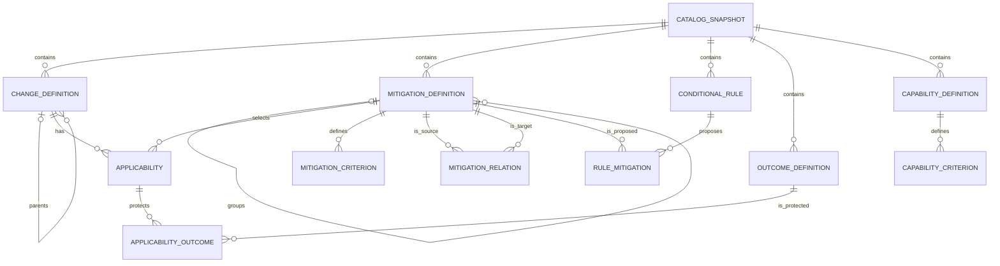
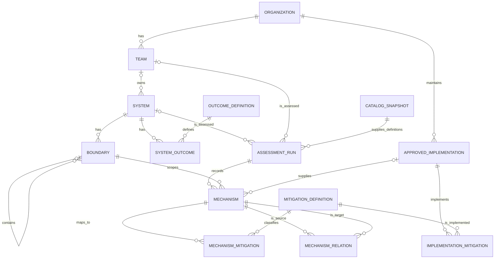
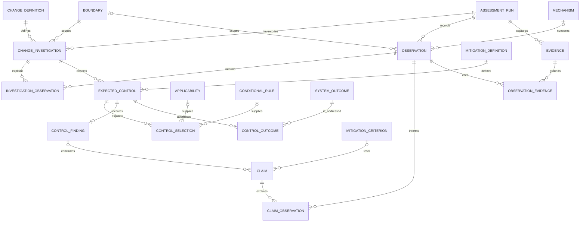
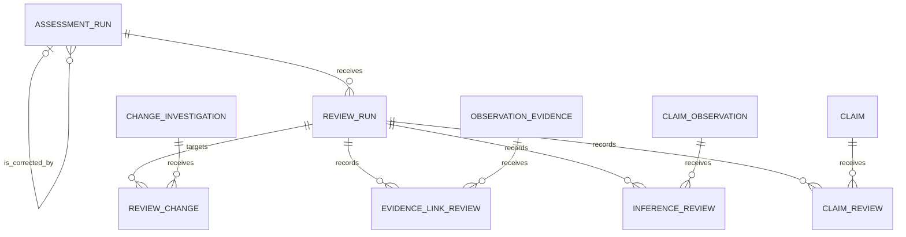
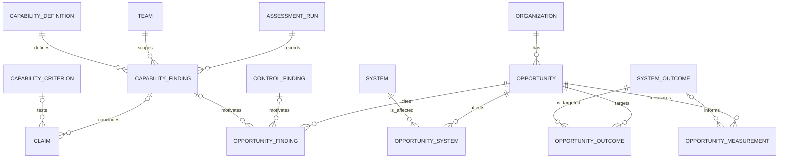

# The proposed data model connects definitions to observations and evidence.

The model has a catalog of expected protections and a record of investigations into actual
systems. A finding refers to a built-in definition and its assessment criteria. Its claims
refer to observations, and each observation refers to the evidence that establishes it.
A review checks both the evidence and the inference from the observation to the claim.

This proposal was revised on 2026-10-12 for review. SQLite is the proposed operational store.
The current application still saves `web/data/catalog.json`; the migration has not been
implemented. The [implementation plan](IMPLEMENTATION-PLAN.md) has the delivery sequence.
Built-in definitions are editable through the UI and are captured for each assessment run.

## The storage boundary separates the public catalog from work data.

The catalog authoring database contains generic definitions, criteria, applicability, and
relations. A separate SQLite workspace database in a work repository contains systems,
investigations, observations, evidence, reviews, and opportunities. An assessment imports
its catalog snapshot into that workspace database so its foreign keys have local targets.
Foreign keys do not cross SQLite schema boundaries.
[SQLite documents this limit](https://www.sqlite.org/foreignkeys.html).

JSON remains an import and deterministic export format for Git review and catalog transfer.
It is not the live persistence layer after migration. Startup does not overwrite the database
from a seed export. Catalog edits, reparenting, and changes to related records have database
transactions and revision checks. Every database connection enables foreign-key enforcement.
[SQLite describes foreign-key enforcement](https://www.sqlite.org/foreignkeys.html) and
[transaction behavior](https://www.sqlite.org/transactional.html).

The diagrams describe the final logical model. A crow's foot means several rows; a circle
means that the relationship is optional. Tables with two parents are explicit join tables.
Catalog records use the composite identity `(catalog_snapshot_id, id)`, and all references
to them include the snapshot. The authoring database has a working catalog; a workspace has
captured catalogs for its runs. This preserves stable definition IDs without invalidation rules.

## The catalog defines what the agent should investigate.

A change definition has its hierarchy level, parent, order, title, description, and guidance.
A mitigation definition is a group or an assessable leaf. A criterion states the claim to
test, the relevant coverage, and evidence expectations. Criteria can concern existence,
coverage, use, exercise, limits, and adverse effects.

Applicability has its reason, mechanism in context, condition, inheritance policy, and any
explicit baseline exception. A mitigation relation has two endpoints, a prerequisite,
alternative, or shared-dependency type, and its scope and reason. Conditional rules propose
mitigations for tailoring. Neither applicability nor an approved implementation proves that
a system has a protection.

## Systems have implementations and mechanisms with stated scope.

A run has either a system or a team as its subject. Product investigations have system runs;
organization capability investigations can have team runs. A boundary names the component,
interface, or support unit in scope. A system outcome has its users, target, measurement
window, exposure, and consequences when known.

An approved implementation is an organization's accepted way of providing one or more
mitigations. A mechanism is the actual configured instance described during a run, such as
a limiter in a request path or an operator procedure used for recovery. It has its owner,
configuration, coverage, and optional approved implementation. One mechanism can provide
several mitigation types, and one mitigation can have several mechanisms. Its mapping is a
classification; effectiveness is established through findings and evidence.

Mechanism relations record actual dependencies and shared failure conditions. A run captures
its system, boundary, and implementation context, and its mechanism records retain the
configuration described in that run. Later edits do not rewrite those observations.

## The investigation records expected work before it records findings.

The investigation inventory has a row for every catalog change within each assessed boundary.
A row has a selected, excluded, or unresolved disposition and a reason. Excluding a branch produces
explicit inherited exclusions for its descendants. An omitted row is therefore distinguishable
from an excluded or evaluated row.

Exclusion and applicability reasons can cite observations through investigation-observation
links. Their evidence uses the same records as criterion claims, so exclusions can be reviewed.

An expected control has its applicability determination and tailoring reason. The expected
rows retain candidate controls that tailoring excludes or leaves unresolved, with their reasons.
Control selection rows retain all contributing baselines and rules, or a manual addition with
its reason. Each
selection has either an applicability reference, a rule reference, or a manual reason. A finding
has its present, partial, absent, unknown, or not-applicable status, conclusion, and search scope.

Preparation creates a draft finding and a draft claim for each applicable criterion before
investigation begins. Their workflow state starts pending, and their determination is empty
until the agent addresses it. A claim has its criterion ID, determination, conclusion text,
and any evidence or access limit. Pending work differs from an investigated unknown. Absence
needs a bounded search record; lack of access or evidence can remain unknown with a reason.

An observation is a statement about what the investigation found. For example, it can state
that a limiter is registered in one request path. Observations can also concern test execution,
interviews, searches, and inspected scope; a missing control does not require an invented mechanism.

Evidence has a repository or document URI, revision when available, line or section locator,
excerpt or inspection result, acquisition method, and captured time. Observation-evidence links
state whether the evidence supports, challenges, or provides context for the observation, with
an explanation. Claim-observation links state how the observed fact supports or challenges the
criterion's conclusion. A source can support several observations, and an observation can inform
several claims without having its text copied into each finding.

The database requires the claim's criterion to belong to the finding's mitigation and snapshot.
It also requires an expected control, finding, claim, observation, and evidence link to remain
within their stated run and permitted boundary. Team observations can have no product boundary.
Composite foreign keys and checked transactions enforce these constraints.

## Review checks the links and the conclusion as separate determinations.

A review run records its assessment and reviewer. Review-change rows capture the selected
investigations and check their disposition, exclusions, and tailoring against the catalog.
Preparing the pass also creates pending rows for each link and claim check. These rows are
the target set, with foreign keys rather than a list of unvalidated IDs.
For a review of all changes, that set includes every claim, every claim-observation link, and
every observation-evidence link reachable from those claims. Reused links are checked once
within the pass, and their review results remain visible from every affected change.

An evidence-link review checks that the source is accessible and that its content supports,
challenges, or provides context for the observation as the link claims, within the stated scope.
An inference review checks that the observation justifies the claim against its built-in
criterion, including conditions, coverage, and contrary evidence.
A claim review records the conclusion-level verdict and explanation. Each check starts pending
and can finish as supported, unsupported, partially supported, or unable to verify.

The review can finish with unsupported or unverifiable conclusions. Completion means every
target was addressed, not that every conclusion passed. Claims marked unknown still receive
a review of whether their limits and recorded search justify that determination. Changes with
unresolved applicability or omitted expected findings remain visible as coverage gaps.

A review targets a completed assessment run whose result records are fixed. Drafts remain
editable. A correction to a completed result creates a successor run with a `supersedes_run_id`
reference and retains the earlier result. This is review provenance, not an expiry or invalidation
system. It introduces no stale states or automatic reruns.

For example, code that defines a limiter supports the observation that the implementation
exists. It does not establish that every request passes through it. The evidence-link check
can pass while the inference supporting full coverage fails.

## Organization findings and opportunities retain the same evidence path.

A claim has either a control finding and mitigation criterion or a capability finding and
capability criterion. Paired nullable foreign keys and a check constraint require exactly
one of these forms. There is no unvalidated generic target ID. Both forms use the same
observation, evidence, and review tables.

An opportunity-finding link similarly has exactly one control or capability finding and
states the reason for citing it. Opportunities name their action, expected result, scope,
priority rationale, uncertainty, implementation result, and effort. Measurements record
expected and observed values with units, windows, and their source. Product protection and
organization capability remain separate even when they motivate the same initiative.

## The visualization changes follow the record meanings.

The catalog mode retains the connection list, hierarchy matrix, and paired outlines from
the comparison. They use the live definitions and applicability links. Cells and paths gain
labels for inheritance, conditions, and exceptions. Selecting a link opens its reason and
criteria; selecting a mitigation can also open its dependency relations.

Assessment mode uses a selected system, boundary, and run. The same connections show finding
statuses and investigation coverage. Selecting a cell opens the definition, criterion,
conclusion, observations, mechanisms, evidence excerpts and source links, and review results.
Catalog applicability and observed protection have different legends and remain distinguishable.

A review view can proceed change by change. It shows the expected and completed work, pending
checks, unsupported inferences, contradictory evidence, and unknowns. Selecting an observation
shows every claim that uses it, while selecting a mechanism shows the mitigations and outcomes
it is believed to protect. A later organization matrix shows findings across systems and can
open the same evidence path.

These records make coverage and review targets queryable. Their foreign keys establish that
the references exist; the review establishes whether their content supports the conclusion.
