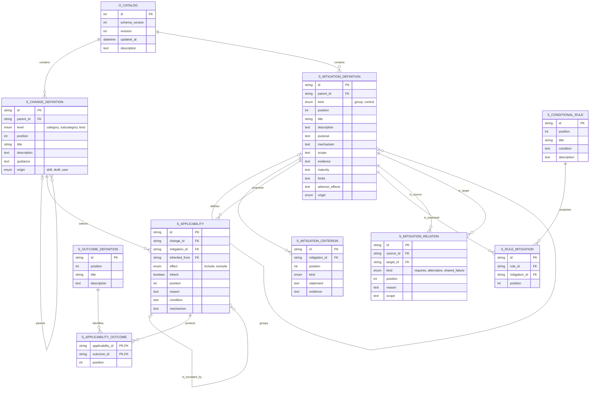
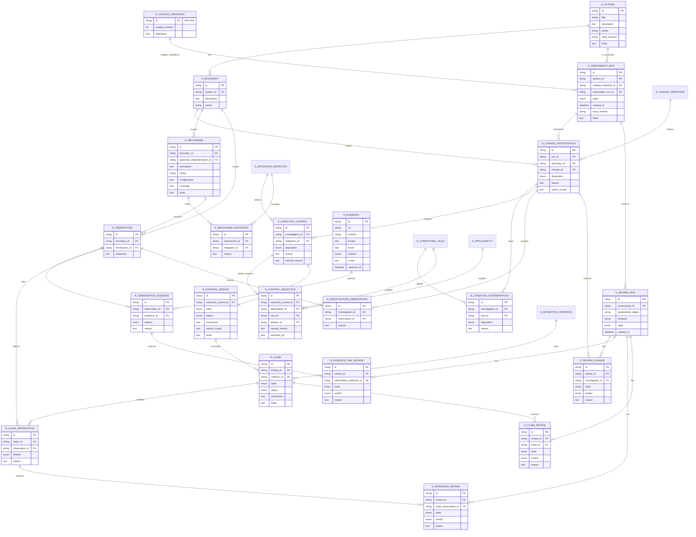

# The software maturity model connects change to protection.

The webapp is an editor for sources of software change, mitigation definitions, and the
relationships between them. Its SQLite catalog is the authority for those definitions.
The investigation Skill uses a captured catalog to examine a system, record what protects
it, and connect each conclusion to observations and evidence.

## The local application has two catalogs and three connection views.

Start the application with Node 22.22.2 or a supported newer version.

```sh
npm install
npm start
```

The application is available at [localhost:4317](http://localhost:4317/). The workflow is in
the sidebar. Sources of change has three columns: categories, subcategories, and kinds of
change. Categories remain visible, and selection opens their children. A fourth column shows
candidate mitigations for the selected change. The columns follow normal page scrolling.

Mitigations has a separate hierarchy of groups and controls. Each control has its definition,
purpose, mechanism, scope, evidence expectations, maturity descriptions, limits, adverse
effects, assessment criteria, and relations to other controls. The criteria distinguish existence, coverage, use, exercise, limits, and adverse effects.
Conditional rules propose
controls for a material path. Outcome definitions describe what a protection can preserve.

Double-click text or press F2 to edit it. Changes to catalog text have an inline editor;
mitigation and relationship text opens a field editor. The menus provide creation, editing,
moving, ordering, and deletion. Drag the handles to reorder siblings or move a record to a
parent. The move dialog provides the same operations with a keyboard. Undo and redo retain
50 edits during a session, including branch deletion and dependent links.

The connection list, hierarchy matrix, and paired outlines use the same definitions and
resolution rules. The matrix has expandable axes and counts change/control pairs in a branch.
Selecting a cell opens the contributing pairs and reasons. The axes can use catalog or name
order without changing the saved hierarchy. Paired outlines draw the selected
change's candidate paths between the trees. These are catalog views; their counts do not
measure a system's protection or maturity.

Each applicability link has a reason, condition, mechanism in context, protected outcomes,
and inheritance policy. An exception refers to one inherited baseline link. Independent
reasons to select the same mitigation remain visible. Moving a branch can leave an exception
inactive; the editor shows that state. Controls have directed prerequisites and symmetric
alternative or shared-failure relations, each with a scope and reason. Prerequisite cycles
are rejected.

## SQLite stores the live catalog.

The database is `web/data/catalog.sqlite`. It has foreign-key enforcement, transaction-based
writes, and a revision check that prevents one tab from overwriting another tab's edits.
Startup creates the database only when its catalog is absent. It preserves existing change
text from `web/data/catalog.json` and supplies the mitigation definitions and links from the
version 2 seed. Subsequent startups use the database and do not reset edits from a seed.

The initial catalog has nine change categories, 52 subcategories, 104 draft kinds, 106 controls
in eight groups, 636 criteria, 1,164 baseline links, 10 conditional rules, and six outcome
definitions. Draft kinds are examples within a parent's scope. Criteria and maturity text
are editable, and an investigation retains uncertainty when evidence cannot establish them.

Export JSON produces a transferable snapshot of both catalogs and their relationships.
Import validates the complete catalog before replacement. Version 1 change-only imports
replace the catalog with their supplied changes and empty mitigation collections; use a
version 2 export to preserve both catalogs. A command-line export is available as well.

```sh
npm run export -- /path/to/catalog.json
npm test
```

Database files are local state and are excluded from Git. JSON exports can be reviewed in
Git. Private system definitions, organization practices, evidence, and results belong in the
organization's work repository. The public catalog contains generic definitions.

## The investigation has expected work and evidence-backed conclusions.

The [investigation Skill](software-maturity-analysis/SKILL.md) uses this process.

1. The investigator defines the system's unit of supportability, boundaries, owners, dependency responsibilities, user outcomes, exclusions, input revision, and evidence limits.
2. The preparation helper captures the catalog and creates an inventory of every change within each boundary. Each change receives a selected, excluded, or unresolved disposition and a reason. The investigator also determines every conditional rule's relevance.
3. The investigator tailors candidate controls from baselines, inherited links, exceptions, conditions, prerequisites, and manual additions. Expected rows retain the reasons for selected, excluded, and unresolved candidates. Findings and criterion claims begin pending.
4. Each work item has one boundary, one change definition, its candidate mitigations, criteria, and evidence expectations. The investigator records mechanisms, observations, and evidence before drawing conclusions. Evidence has a source URI, revision when available, locator, inspected excerpt or result, method, scope, and capture time.
5. Each criterion claim refers to observations, and each observation refers to evidence through links with a relation and rationale. Findings distinguish present, partial, absent, unknown, and not-applicable protections. Absence requires a bounded search; unknown requires an evidence or access limit.
6. A separate review has targets for every change, observation/evidence link, claim/observation link, and criterion claim. The reviewer verifies the source's support for the observation and then the observation's support for the conclusion. Unsupported and unverifiable conclusions remain explicit.

For example, code that defines a limiter supports an observation that the implementation
exists. That observation alone does not establish that every request passes through it.
The evidence check can pass while the coverage inference fails.

The Skill has [record definitions and helper commands](software-maturity-analysis/references/record-format.md).
Investigation and review helpers produce portable JSON records in the work repository.
The webapp currently edits the catalog; result storage and visualization are separate from
this catalog interface. The process has no expiration, invalidation, or automatic reassessment
rules. A corrected completed investigation has a successor run and its own review.

## The ERD labels three classes of records.

The `S_` prefix labels **“things that are part of the Skill.”** These are definitions that you
populate and edit through the catalog. The `R_` prefix labels **“things that are discovered
at runtime.”** The Skill instructs the investigator to fill these records. The `O_` prefix
labels **“other.”** These records define scope, capture inputs, enumerate expected work,
and retain review state.

The first diagram describes the catalog stored in SQLite. The second diagram describes the
investigation and review record contract, whose runtime UI and SQLite persistence are not
part of the catalog editor. IDs on a captured catalog are interpreted within that snapshot.
A private workspace database will import the captured definitions locally; its foreign keys
will not cross into the public authoring database. The [data model](DATA-MODEL.md) has the
constraints and the organization and opportunity relationships.





The catalog foreign keys establish that definitions and relationships exist. Investigation
validation establishes expected-work coverage and reference integrity. Review establishes
whether linked content supports a conclusion.
